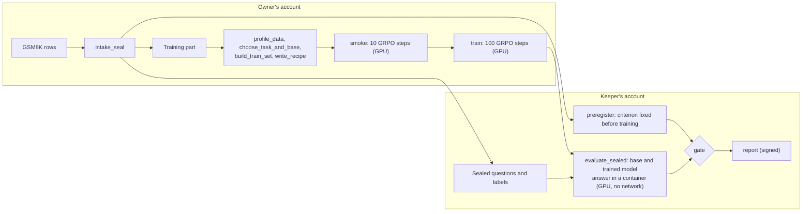

# gatedtrain-pack-text-gsm8k

A scenario pack for [gatedtrain](https://github.com/gatedtrain/gatedtrain) (`gatedtrain>=0.6,<0.7`): it teaches a small
language model grade-school math and lets gatedtrain decide, by a rule fixed before training, whether the trained
model really is better.

It trains Qwen3-0.6B with TRL GRPO on GSM8K questions on your GPU. Before training, gatedtrain's keeper seals part of
your questions away; after training, the keeper answers those sealed questions with the base and the trained model and
scores each response by the number it gives as its answer. The gate passes only when the trained model beats the base by the
registered rule.

It is a prototype: the models it trains are not promotable.

## How it works

The owner (you) prepares data and trains; the keeper, a service under its own OS user, holds the sealed questions and
runs the evaluation. The boxes below name the stages of the pack's pipeline.



The container gets the sealed questions, never their labels; the keeper scores the answers itself.

## Changes in 0.2.0

- Needs gatedtrain 0.6 (the pack and the VLM pack can now share one keeper environment).
- **Greedy decoding is the default** (`decoding: greedy`, temperature 0, top_p 1.0, one evaluation seed, one sample per
  item); `decoding: sampled` in the `choose_task_and_base` params keeps the 0.1.0 mode (temperature 0.7, four seeds).
  See "Decoding". No GPU end to end run of this release was made: the run below is the 0.1.0 run (sampled decoding),
  and the greedy path is covered by the CPU tests (fake containers) and the determinism probe described below.

## Decoding

gatedtrain 0.6 registers greedy decoding as an explicit mode and its keeper checks it: every sealed item is generated
once more under a seed the registration does not name, and an attempt whose predictions differ is refused after it
spent its alpha (AN-26). vLLM's default batching is not deterministic, so the batch generator runs greedy decoding one
request at a time (`max_num_seqs=1`, prefix caching off). Probe of this pack (the keeper's container flags and eval
environment, vLLM 0.31.0, 399 GSM8K rows from the training part of an earlier project, never sealed items, two seeds in one
call, 1,024 new tokens):

| Model | Default batching: items that differ | `max_num_seqs=1`: items that differ | Time for both passes |
|---|---|---|---|
| Base (Qwen3-0.6B) | 239/399 (59.9 %) | **0/399** | 17 min 42 s |
| Trained (100 GRPO steps) | 205/399 (51.4 %) | **0/399** | 17 min 33 s |

**Time limit.** One request at a time is slow: about 17.5 minutes per arm against the generator's limit of 20 minutes
(the keeper allows at most 1,200 s), a margin of about 10 %. A slower GPU or a busier host can exceed it; the attempt is
then a crash that costs its alpha. Use `decoding: sampled` (under two minutes per arm in the default-batching probe) when the margin is too small for
your host. A change of the generator, the vLLM version or the GPU needs the probe again.

## A tested run (0.1.0, sampled decoding)

One run on one 24 GB GPU, with 7,074 GSM8K training-split rows for training and 399 rows sealed for the test. Scores are
at temperature 0.7 over four seeds, so they are not the scores of the greedy mode:

| | Score on the sealed questions |
|---|---|
| Base (Qwen3-0.6B) | 0.659 |
| Trained (100 GRPO steps) | 0.762 |
| Gate | **PASS**: +0.103, 95.25 % interval [0.0739, 0.1335] |

About 0.64 GPU hours in all (training 0.51 h). Your numbers will differ with other data, seeds and hardware.

## What you need

- Linux x86_64, one NVIDIA GPU, a CUDA 13.0 driver; CPython 3.12 for both venvs.
- gatedtrain 0.6 with a keeper and rootless Docker for the owner and the keeper (see gatedtrain's
  [AI-native projects](https://github.com/gatedtrain/gatedtrain/blob/main/docs/ai-native.md) guide).
- Root, once, to install the pack in the keeper's environment and to build the keeper's eval tree.

## Install

The pack is not on PyPI. Install it from this repository at a release tag, into the environment of the `gatedtrain` you
run, as the owner:

```sh
pip install "gatedtrain-pack-text-gsm8k @ git+https://github.com/gatedtrain/gatedtrain-pack-text-gsm8k@v0.2.0"
```

The keeper's own environment needs the same pack at the same version (see "The keeper's environment" below).

What the pack registers with gatedtrain:

| Entry point group | Name | Object |
|---|---|---|
| `gatedtrain.scenarios` | `text-gsm8k` | `scenario.py` `SCENARIO`: the batch generator `text_gsm8k_vllm`, the scorer `gsm8k_answer`, `pipeline.yaml` |
| `gatedtrain.stages` | `gsm8k_profile_data`, `gsm8k_choose_task_and_base`, `gsm8k_build_train_set`, `gsm8k_write_recipe`, `gsm8k_smoke`, `gsm8k_train` | `stages.py` |
| `gatedtrain.adapters` | `text-gsm8k-grpo` | `adapter.py` `PLUGIN`: the training job's trainer row and the evaluator row |
| console script | `gatedtrain-pack-text-gsm8k-data` | `data.py`: GSM8K rows to the intake format |

The pack derives from the recipe
[`gatedtrain-recipe-trl-grpo-gsm8k`](https://github.com/gatedtrain/gatedtrain-recipe-trl-grpo-gsm8k) (its training
script and its runtime lock). It has no per-item generator: a project needs a keeper, which runs the batch generator
`text_gsm8k_vllm` (`generate_vllm.py`, vLLM) in its inference container on the GPU. The scorer `gsm8k_answer`
(`answer.py`, standard library only) takes the number of the first `\boxed{}`, else the first number after the last
"The answer is", else the last number in the response, and compares it with the label as a decimal.

## Setting up, in order

1. [Prepare the host](#preparing-the-host-the-owner-no-sudo) as the owner: the base model, the training runtime, the
   data and the image.
2. Install the pack in [the keeper's environment](#the-keepers-environment) (root).
3. Build [the keeper's eval tree](#the-keepers-eval-tree) (root).
4. Fill in [the pipeline params](#the-pipeline-params) and [run the project](#running-a-project).

## Preparing the host (the owner, no sudo)

Everything in this section runs as the owner. The paths are examples; `/srv/gatedtrain` is the owner's tree.

1. Fetch the base model at the pinned commit. The directory is a pipeline param (`choose_task_and_base.base_model_dir`):

   ```sh
   uvx --from huggingface_hub hf download Qwen/Qwen3-0.6B --revision c1899de289a04d12100db370d81485cdf75e47ca \
       --local-dir /srv/gatedtrain/models/Qwen3-0.6B
   ```

   The stage checks that the directory holds a Qwen3 `config.json`, the weights and the tokenizer files, and copies
   the six deployable files (`config.json`, `generation_config.json`, `model.safetensors`, `tokenizer.json`,
   `tokenizer_config.json`, `chat_template.jinja`) for the keeper. The download at this commit has no
   `chat_template.jinja`: its chat template is the string field `chat_template` of `tokenizer_config.json`. The stage
   then writes that string, byte for byte as UTF-8, to the copy's `chat_template.jinja` (the download is left as it
   is); a directory with neither a `chat_template.jinja` nor a non-empty string `chat_template` is refused.

2. Build the training runtime venv with a uv-managed CPython 3.12. The runtime directory holds the pack's copies of
   `runtime/pyproject.toml` and `runtime/uv.lock` (the recipe's lock). Copy them out of the installed package into a
   directory of yours, **and** set `GATEDTRAIN_PACK_TEXT_GSM8K_RUNTIME` to that directory in the environment of every
   `gatedtrain` process that runs `smoke` or `train` (the default is the package's own `runtime/`). The adapter reads
   the variable and `<runtime>/.venv/pyvenv.cfg` when it is imported, so the venv must exist before that process
   starts, and the directory must equal the pipeline params `smoke.runtime_dir` and `train.runtime_dir`. `smoke` and
   `train` refuse in their plan, before any GPU job, when the directory differs, when `<runtime>/.venv/bin/python` is
   missing, or when `<runtime>/uv.lock` is not the pack's `runtime/uv.lock`. Build **without bytecode**:

   ```sh
   uv python install 3.12.16 --install-dir /srv/gatedtrain/python
   mkdir -p /srv/gatedtrain/runtime-gsm8k
   cp <site-packages>/gatedtrain_pack_text_gsm8k/runtime/pyproject.toml \
      <site-packages>/gatedtrain_pack_text_gsm8k/runtime/uv.lock /srv/gatedtrain/runtime-gsm8k/
   cd /srv/gatedtrain/runtime-gsm8k
   env -u UV_COMPILE_BYTECODE UV_PROJECT_ENVIRONMENT=$PWD/.venv UV_LINK_MODE=copy UV_PYTHON_DOWNLOADS=never \
       uv sync --frozen --python /srv/gatedtrain/python/cpython-3.12.16-linux-x86_64-gnu/bin/python3.12
   export GATEDTRAIN_PACK_TEXT_GSM8K_RUNTIME=/srv/gatedtrain/runtime-gsm8k   # in every shell that runs gatedtrain
   ```

   Do not add `--compile-bytecode`: the job's key fingerprints every entry of the read-only runtime mount and refuses
   more than 100,000 entries (`gatedtrain.ainative.backend.MAX_INPUT_ENTRIES`), and a venv with compiled bytecode
   exceeds that. The runs write no bytecode either (`PYTHONDONTWRITEBYTECODE=1`). The job mounts the whole runtime
   directory read-only (not just `.venv`), so the adapter row's credential-scan skip for the venv applies.

3. Convert the GSM8K rows (JSONL with `question` and `answer`, the answer ending with a `#### <number>` line) to the
   intake format. Hugging Face ships GSM8K (`openai/gsm8k`, config `main`) as parquet; export the rows you want as
   JSONL first, for example the train split at the recipe's dataset commit:

   ```sh
   uv run --no-project --with datasets python -c "from datasets import load_dataset; load_dataset('openai/gsm8k', \
       'main', split='train', revision='740312add88f781978c0658806c59bc2815b9866').to_json('gsm8k-main.jsonl')"
   ```

   The command refuses with line numbers only, never row content, and writes nothing when any row is refused or the
   source holds no row:

   ```sh
   gatedtrain-pack-text-gsm8k-data --src gsm8k-main.jsonl --dst intake.jsonl
   ```

4. Pull the recipe's CUDA devel image into the owner's rootless daemon (no job pulls an image):
   `docker.io/nvidia/cuda:13.0.3-devel-ubuntu24.04@sha256:b7ae301dea2c162444795462ce17a05f6a516e5a75944b57af5b88540a1a2266`.

Rules: TXT-2 (the base model files), TXT-4 (the runtime directory and the 100,000-entry limit).

## The keeper's environment

The keeper checks, before it starts a generator, that the generator's script is a file of a distribution in the
keeper's own environment record (gatedtrain, the scenario packs and their dependencies), so the pack must be installed
in the keeper's own environment, the root-owned venv `gatedtrain setup keeper` installs (`/opt/gatedtrain-keeper/venv`
by default), at the same version as the owner's. `gatedtrain setup keeper` prints that install line with the packs
installed for the owner at their versions (`--packages gatedtrain-pack-text-gsm8k==<version>` names it); the printed
`pip install ... gatedtrain-pack-text-gsm8k==<version>` resolves only from PyPI, where the pack is not published. Root
installs it from this repository at the same tag as the owner's instead:

```sh
sudo /opt/gatedtrain-keeper/venv/bin/pip install --no-cache-dir \
    "gatedtrain-pack-text-gsm8k @ git+https://github.com/gatedtrain/gatedtrain-pack-text-gsm8k@v0.2.0"
```

Restart the keeper after installing or upgrading the pack.

## The keeper's eval tree

The keeper's inference container runs `generate_vllm.py` with the python of a root-owned eval venv. The pack ships the
inputs for it: `eval-requirements.txt` (hash-pinned, binary wheels only: vllm 0.31.0, transformers 5.17.0,
torch 2.13.0 and their locked dependencies, the versions of the runtime lock) and the lock it was exported from
(`eval/pyproject.toml`, `eval/uv.lock`; the comment in the pyproject says how to regenerate it). Find them in the
installed package, then print the host setup script and read it before running it as root (`gatedtrain setup host
--help` lists the other flags):

```sh
gatedtrain setup host \
    --inference-image docker.io/nvidia/cuda:13.0.3-devel-ubuntu24.04@sha256:b7ae301dea2c162444795462ce17a05f6a516e5a75944b57af5b88540a1a2266 \
    --eval-requirements <site-packages>/gatedtrain_pack_text_gsm8k/eval-requirements.txt \
    --eval-python /opt/gatedtrain-keeper/python/<cpython-3.12>/bin/python3.12
```

The script builds `/opt/gatedtrain-keeper/eval-venv` from that interpreter, which must already sit under
`/opt/gatedtrain-keeper/python`: root installs a standalone CPython there before running the script, with
`env UV_PYTHON_INSTALL_DIR=/opt/gatedtrain-keeper/python uv python install 3.12` (the script checks that the tree is
root-owned and not group- or other-writable, and does not install it itself). The keeper serves the eval venv
read-only to its containers. The generator's interpreter is `/opt/gatedtrain-keeper/eval-venv/bin/python`; set
`GATEDTRAIN_PACK_TEXT_GSM8K_EVAL_PYTHON` to another absolute path in the keeper's own environment when the eval venv
lives elsewhere. The keeper still runs it only when that interpreter is a regular file inside one of its `--eval-tree`
directories.

## The pipeline params

`pipeline.yaml` leaves these params null; a stage refuses to run until they are set. Copy the file, fill them in and pass
the copy to `gatedtrain project create --pipeline <copy> --keeper <socket>`:

| Param | Value |
|---|---|
| `choose_task_and_base.base_model_dir` | the Qwen3-0.6B directory fetched above, e.g. `/srv/gatedtrain/models/Qwen3-0.6B` |
| `choose_task_and_base.decoding` | optional: `greedy` (the default) or `sampled` |
| `smoke.image`, `train.image` | the CUDA devel image pinned by digest, held by the owner's rootless daemon |
| `smoke.runtime_dir`, `train.runtime_dir` | the runtime directory holding the owner-built `.venv`, e.g. `/srv/gatedtrain/runtime-gsm8k`; the value of `GATEDTRAIN_PACK_TEXT_GSM8K_RUNTIME` |
| `smoke.python_dir`, `train.python_dir` | the directory of uv-managed interpreters the venv was made from, e.g. `/srv/gatedtrain/python` |

`smoke` and `train` take the same three values. `write_recipe.profile_steps` is optional (the recipe's value is the only
one accepted).

## Running a project

A project runs the pipeline one stage at a time with `gatedtrain project run`; `gatedtrain project plan` shows what a
stage would do first, and `gatedtrain project report` prints the gate report at the end. Creating a project with a
keeper, confirming the metric and checking the signed records with `verify` are described in gatedtrain's
[AI-native projects](https://github.com/gatedtrain/gatedtrain/blob/main/docs/ai-native.md) guide. `smoke` and `train`
need the GPU and count against the project's GPU-hour budget; `evaluate_sealed` runs on the GPU too, in the keeper's
container.

## What the keeper checks and what is cooperative

This section follows gatedtrain's
[AI-native projects](https://github.com/gatedtrain/gatedtrain/blob/main/docs/ai-native.md) guide.

The keeper checks, from its own signed records: the models it evaluates (it copies the files a model reference lists
into its own state and checks their hashes), the sealed set and its labels (the container gets the sealed inputs, never
the labels), the container it runs the generator in (rootless daemon, `--network none`, `--read-only`,
`--cap-drop ALL`, one container per arm), the alpha spent per attempt, and the container seconds of the report's
`compute` block. A `/out` that does not hold exactly one well-formed `predictions.jsonl` is a crash that has spent its
alpha.

What is cooperative: the training side. The job records, the GPU budget, the GPU log and the `ctx.backend` rules hold
for drivers and stages that use the backend; anything running as the owner can start containers on the owner's daemon
itself or edit the project's records. The budget is enforced while a driver polls the job. The backend's job totals the
driver sends with the report request are "the driver's job records (cooperative, not checked by the keeper)". The
rootful-access check does not cover sudo, and `rootless = true` in the host file is the host file's word.

## Limits

- Linux x86_64, one NVIDIA GPU, a CUDA 13.0 driver; CPython 3.12 for both venvs.
- The base model is Qwen3-0.6B only; the stage checks its architecture.
- The training script is the recipe's: TRL GRPO, `smoke` (10 steps) and `full` (100 steps) profiles, no resume (a
  preemption restarts from step 0), `beta=0.0` (no reference model).
- The scorer reads the final number only; the training reward (math-verify) is a different function, so a gain on the
  sealed set is measured by `gsm8k_answer`, not by the training reward.
- The runtime venv must be built without bytecode and kept under 100,000 entries.
- A prototype: the models it trains are not promotable.

## License

Apache License, Version 2.0 (`LICENSE`). See `NOTICE` for the copyright notice and `THIRD_PARTY_NOTICES.md` for the
third-party text the pack includes.

Names of third-party projects and products are trademarks of their owners; this pack is not affiliated with or
endorsed by them.
